# Project Overview: SkillGap Analyzer (Bridge-IQ)

> **Bridge-IQ / SkillGap Analyzer** is an AI-powered talent intelligence and multi-tier enterprise career acceleration platform. It connects software engineering candidates, corporate recruiters, and system administrators through automated ATS resume parsing, intelligent job-fit gap analysis, adaptive 12-week roadmaps, proctored dual-stage skill assessments, live global job market aggregation, and a superadmin platform governance suite.

---

## 1. System Architecture

```mermaid
graph TD
    subgraph Frontend ["Frontend (React 19 + Vite 8 + Tailwind v4)"]
        UI_Landing["Landing Page & Auth (/ , /candidate/signup)"]
        UI_Candidate["Candidate Portal (/candidate/*)"]
        UI_Employer["Employer Portal (/employer)"]
        UI_Admin["👑 Admin Portal (/admin)"]
        UI_Analyzer["Skill Gap Analyzer (/analyzer)"]
        UI_Jobs["Live Job Market (/jobs)"]
        UI_Practice["Proctored Assessment Engine (/candidate/practice)"]
        LocalStore[("Browser LocalStorage (Resilient Offline Cache)")]
    end

    subgraph Backend ["Backend (FastAPI + Python 3)"]
        API_Main["FastAPI Router (main.py)"]
        API_Admin["Admin Governance Endpoints (/api/admin/*)"]
        Svc_Resume["Resume Extractor (pypdf + 350+ Taxonomy + Gemini)"]
        Svc_Gap["Gap Engine (Alias Resolver & Matcher)"]
        Svc_Quiz["Quiz & Challenge Generator (Gemini + Curated Banks)"]
        Svc_Code["Code Evaluator (Isolated Subprocess Runner)"]
        Svc_Jobs["Job Search Service (RapidAPI JSearch /search-v2)"]
        Svc_Roadmap["Roadmap Generator (Structured 4-12 Week AI Curricula)"]
    end

    subgraph External ["External Services & Data"]
        Gemini["Google Gemini AI (3.8-Flash / 2.0-Flash)"]
        Supabase[("Supabase PostgreSQL & Auth")]
        RapidAPI["RapidAPI JSearch Engine"]
    end

    UI_Landing --> Supabase
    UI_Candidate <--> LocalStore
    UI_Candidate --> Supabase
    UI_Employer --> API_Main
    UI_Employer --> Supabase
    UI_Admin --> API_Main
    UI_Admin --> API_Admin
    UI_Admin --> Supabase
    UI_Analyzer --> API_Main
    UI_Jobs --> API_Main
    UI_Practice --> API_Main

    API_Main --> Svc_Resume
    API_Main --> Svc_Gap
    API_Main --> Svc_Quiz
    API_Main --> Svc_Code
    API_Main --> Svc_Jobs
    API_Main --> Svc_Roadmap

    Svc_Resume --> Gemini
    Svc_Quiz --> Gemini
    Svc_Roadmap --> Gemini
    Svc_Jobs --> RapidAPI
    API_Main --> Supabase
    API_Admin --> Supabase
```



---

## 2. Technology Stack

### Frontend
| Component | Technology | Version / Spec | Purpose |
| :--- | :--- | :--- | :--- |
| **Framework** | React | `^19.2.8` | Core UI library |
| **Runtime / Bundler** | Vite | `^8.3.0` | Dev server with instant HMR and ES module bundling |
| **Routing** | React Router DOM | `^7.18.4` | Client-side routing with nested layouts and 3-way role gating (`candidate`, `employer`, `admin`) |
| **Styling** | Tailwind CSS v4 | `^4.3.3` | Utility-first CSS with native `@import "tailwindcss";` & `@theme` design tokens |
| **Linter** | Oxlint | `^1.81.0` | Ultra-fast Rust-based JavaScript / React linter |
| **Client Database** | Supabase JS | `^2.117.2` | Client-side authentication, session persistence, and PostgreSQL data access |
| **Hosting Config** | Netlify | `netlify.toml` + `_redirects` | Static single-page application deployment with fallback redirects |

### Backend
| Component | Technology | Version / Spec | Purpose |
| :--- | :--- | :--- | :--- |
| **Framework** | FastAPI | Latest | High-performance asynchronous REST API |
| **ASGI Server** | Uvicorn | `[standard]` | Production-ready ASGI server |
| **Data Validation** | Pydantic | Latest | Request/response schema definitions and text sanitization |
| **Database Connector** | Supabase Python | Latest | Server-side data sync and table inserts |
| **PDF Extraction** | PyPDF | Latest | Binary stream parsing and text extraction from resume uploads |
| **AI / LLM** | Google Generative AI | `google-generativeai` | LLM invocation (`gemini-3.8-flash`, `gemini-flash-latest`, `gemini-2.0-flash`) |
| **Networking** | Requests & urllib | Standard library / pip | RapidAPI JSearch integration and external API queries |
| **Environment** | python-dotenv | Latest | Multi-directory `.env` variable loading and fallback resolution |

---

## 3. Directory Structure

```plaintext
SkillGap/
├── .env.example                     # Reference template for API keys & database credentials
├── .gitignore                       # Standardized exclusion for env files, node_modules, dist, venv
├── PROJECT.md                       # Comprehensive architectural & security documentation
│
├── backend/                         # FastAPI Python Backend
│   ├── .env                         # Server environment configuration (API keys, Supabase)
│   ├── .gitignore                   # Backend-specific ignore rules
│   ├── database.py                  # Supabase client instantiation & error logging
│   ├── main.py                      # FastAPI entry point, CORS, REST endpoints, and Admin APIs
│   ├── requirements.txt             # Python dependencies
│   ├── services/                    # Core business logic & AI services
│   │   ├── ai_extractor.py          # Gemini AI extraction of tech & soft skills from JD
│   │   ├── code_evaluator.py        # Subprocess runner evaluating Python, JS, HTML/CSS against 6 test cases
│   │   ├── gap_engine.py            # Alias resolution (50+ mappings) and token-boundary match engine
│   │   ├── job_search.py            # RapidAPI JSearch client with query formatting and logging
│   │   ├── quiz_generator.py        # Curated 20-question banks + dynamic Gemini quiz generator
│   │   ├── resume_extractor.py      # Hybrid PDF parser: pypdf + Gemini + 350+ taxonomy scanner
│   │   └── roadmap_generator.py     # 4-week to 12-week customized learning roadmap generator
│   └── venv/                        # Python virtual environment (ignored by git)
│
└── frontend/                        # React 19 + Vite Frontend
    ├── index.html                   # HTML entry point with Plus Jakarta Sans typography
    ├── netlify.toml                 # Netlify build command and SPA redirect rules
    ├── package.json                 # Node manifest with scripts and dependencies
    ├── vite.config.js               # Vite configuration with React and Tailwind plugins
    ├── public/                      # Static assets (_redirects, favicon.svg, icons.svg)
    └── src/                         # Application source code
        ├── App.jsx                  # Master router, 3-role session management, modals
        ├── config.js                # API base URL and client key resolutions
        ├── index.css                # Tailwind v4 theme configuration & custom scrollbars
        ├── main.jsx                 # React root mount
        ├── components/              # Reusable UI widgets
        │   ├── AuthModal.jsx        # 3-Role (Candidate/Employer/Admin) login & registration modal
        │   ├── CandidateDashboard.jsx # Embedded candidate overview widget
        │   ├── CandidateSignUp.jsx  # Candidate onboarding & account creation page
        │   ├── ErrorBoundary.jsx    # React error boundary catching render crashes
        │   ├── LandingPage.jsx      # High-conversion marketing landing page
        │   ├── LanguageLogo.jsx     # Authentic vector SVG logos for 20+ programming languages
        │   ├── LearningRoadmap.jsx  # Visual timeline component for 4-week roadmap
        │   ├── LiveJobSearch.jsx    # Live market search with multifaceted filtering & bookmarking
        │   ├── Navbar.jsx           # Global responsive navigation header with role selector
        │   ├── ResumeUploader.jsx   # Drag-and-drop resume uploader (PDF / raw text)
        │   └── SkillGapAnalyzer.jsx # Core analyzer comparing user skills vs job descriptions
        ├── context/
        │   └── ToastContext.jsx     # Global toast notification dispatch system
        ├── layouts/
        │   └── CandidateLayout.jsx  # Persistent sidebar/navigation shell for candidate portal
        ├── lib/
        │   ├── auth.js              # Supabase authentication wrappers, Master Admin emails, and profile upsert
        │   └── supabaseClient.js    # Supabase client initializer with offline mock fallback
        ├── pages/
        │   ├── AdminPortal.jsx      # 👑 Superadmin Command Center (Users, Jobs, Audits, Bank, Telemetry)
        │   ├── CandidateHome.jsx    # Candidate home dashboard (metrics, activity, target roles)
        │   ├── CandidatePractice.jsx# Proctored 2-stage assessment engine (20 MCQs + 2 Coding)
        │   ├── CandidateProfile.jsx # 18-field complete professional profile builder
        │   ├── CandidateRoadmap.jsx # 12-week personalized curriculum with tracking
        │   ├── Dashboard.jsx        # Role-based dashboard router with 3-role sandbox switcher
        │   ├── EmployerPortal.jsx   # Enterprise recruiter suite (Job CRUD, Talent Pool, Invites)
        │   └── Onboarding.jsx       # Initial candidate profile configuration wizard
        ├── services/
        │   ├── adminService.js      # Admin telemetry, user role updates, job moderation, question curation
        │   ├── employerService.js   # Employer jobs, shortlists, invitations, applications CRUD
        │   └── persistenceService.js# Supabase-to-LocalStorage sync for bookmarks and analyses
        └── utils/
            └── cleanText.js         # HTML entity sanitization, salary & relative date formatters
```

---

## 4. Main Entry Points & API Contracts

### Backend Entry Point: [`backend/main.py`](file:///c:/Users/Anu%20Priya/Desktop/SkillGap/backend/main.py)
Executed via:
```bash
uvicorn main:app --reload --port 8000
```

#### Key Endpoints:
- `GET /` & `GET /api`: Health check status.
- `GET /api/db-check`: Supabase database connectivity verification.
- `POST /api/analyze-gap`: Evaluates candidate skills against a job description, returns match percentage, matched skills, missing skills, and auto-generates a roadmap.
- `POST /api/extract-resume`: Accepts Base64-encoded PDF or raw text, invokes hybrid extractor, and returns canonical skill list.
- `POST /api/live-jobs`: Queries RapidAPI JSearch with search term and location.
- `POST /api/generate-quiz`: Generates 20 diagnostic MCQs (curated + Gemini AI).
- `POST /api/generate-coding-challenge`: Generates 2 algorithmic challenges tailored to the selected language.
- `POST /api/evaluate-coding-challenge`: Executes submitted code against 6 test cases (4 public + 2 hidden).
- `GET|POST|PUT|DELETE /api/employer/jobs`: Full CRUD endpoints for enterprise job listings.
- `POST /api/employer/invite`: Issues a unique assessment invitation token for candidate screening.
- **Admin Governance Endpoints**:
  - `GET /api/admin/metrics`: Platform-wide telemetry (total candidates, recruiters, admins, active jobs, and assessments).
  - `POST /api/admin/users/role`: Elevates or modifies user role permissions.
  - `POST /api/admin/jobs/moderate`: Approves, flags, or updates employer job statuses.
  - `POST /api/admin/questions`: Dynamically deploys new diagnostic questions to the exam bank.
  - `GET /api/admin/health`: Live connectivity verification for Gemini AI, Supabase, and RapidAPI.

### Frontend Entry Point: [`frontend/src/main.jsx`](file:///c:/Users/Anu%20Priya/Desktop/SkillGap/frontend/src/main.jsx) & [`frontend/src/App.jsx`](file:///c:/Users/Anu%20Priya/Desktop/SkillGap/frontend/src/App.jsx)
Executed via:
```bash
npm run dev
```

#### Routes:
- `/`: Public marketing landing page with feature showcase.
- `/candidate/signup`: Candidate account registration.
- `/candidate`: Candidate layout containing:
  - `/candidate/home`: Overview of progress, applications, invitations, and bookmarks.
  - `/candidate/practice`: Two-stage proctored technical assessment engine.
  - `/candidate/roadmap`: 12-week role-calibrated study curriculum.
  - `/candidate/profile`: 18-field professional profile & resume manager.
- `/employer`: Enterprise portal with job management, talent search, and candidate invitations.
- `/admin`: Superadmin Command Center (Executive KPIs, User Directory, Job Moderation, Question Bank, Submission Audits, Telemetry).
- `/analyzer`: Direct access to the Skill Gap Analyzer tool.
- `/jobs`: Live market job aggregation engine with faceted search and 1-click apply.
- `/dashboard`: Unified role-based dashboard with instant 3-way sandbox role switcher (`Candidate` $\leftrightarrow$ `Employer` $\leftrightarrow$ `Admin`).

---

## 5. Key Subsystems & Workflows

### 1. Hybrid Resume Parsing & Skill Taxonomy
- **Pipeline**: PDF binary bytes $\rightarrow$ `pypdf` page text extraction $\rightarrow$ Gemini 3.8-Flash prompt $\rightarrow$ 350+ curated canonical taxonomy boundary scanner $\rightarrow$ alias normalization $\rightarrow$ deduplicated output.
- **Resilience**: If the Gemini API fails or times out (6s limit), the deterministic taxonomy scanner guarantees zero empty results.

### 2. Intelligent Gap Analysis Engine
- Resolves abbreviations and variants (e.g., `k8s` $\rightarrow$ `kubernetes`, `ts` $\rightarrow$ `typescript`, `react.js` $\rightarrow$ `react`).
- Strict matching guards prevent false positives for short programming languages (`c`, `r`, `go`, `sql`).
- Calculates match percentage: $\frac{\text{matched}}{\text{total required}} \times 100$.

### 3. Proctored Dual-Stage Assessment Engine
- **Stage 1 (Diagnostic MCQs)**: 20 conceptual questions with 35-minute countdown, category tracking, code snippets, question flagging, and detailed explanations.
- **Stage 2 (Live Coding Challenges)**: 2 algorithmic challenges with 45-minute countdown, 6 test cases (4 public + 2 hidden). Code executed in isolated backend subprocesses.
- **Proctoring**: Exit confirmation modal, browser navigation traps (`popstate`), and session state caching.
- **Daily Rate Limiting**: Enforces a 3 test/day limit per user to maintain credential validity.

### 4. Dual-Role Enterprise System
- **Candidates**: Profile completion tracker (18 verified fields), assessment badges, bookmarks, and direct application submission.
- **Employers**: Post and edit openings, search verified candidate talent pools, filter by match score and L1 assessment results, and send invitation tokens.

### 5. Superadmin Governance & Platform Control
- **Authorized Master Administrators**:
  - `aadhilakshmanan07@gmail.com`
  - `anukarthika02@gmail.com`
- **Key Modules in Admin Portal**:
  - **Overview & KPIs**: Platform-wide telemetry (Total candidates, active recruiters, exams passed, API latency).
  - **User & Talent Directory**: Searchable directory with 1-click role elevation (`candidate` $\leftrightarrow$ `employer` $\leftrightarrow$ `admin`), verification toggles, and CSV export.
  - **Job Moderation Queue**: Quality control pipeline to approve, flag, feature, or delete job postings.
  - **Question Bank Manager**: Add custom diagnostic MCQs or coding problems with test cases without touching source code.
  - **Submission Audit Inspector**: Inspect raw source code submitted by candidates, review test case execution outputs, and audit proctoring flags.
  - **Infrastructure Telemetry**: Real-time health checks on Gemini AI, Supabase connection pool, and JSearch quotas.

### 6. Role-Based Access Control (RBAC) Matrix

| Feature / Permission | Candidate | Employer | Master Admin |
| :--- | :---: | :---: | :---: |
| Run Skill Gap Analysis & AI Roadmap | ✅ | ✅ | ✅ |
| Take Proctored Exams & Earn Badges | ✅ | ❌ | ✅ (Preview) |
| Post & Edit Job Openings | ❌ | ✅ | ✅ (Supervise) |
| Search Talent Pool & Send Invites | ❌ | ✅ | ✅ |
| Moderate / Approve Job Postings | ❌ | ❌ | ✅ |
| Inspect Candidate Source Code Submissions | ❌ | ❌ | ✅ |
| Add Custom Questions to Exam Bank | ❌ | ❌ | ✅ |
| Change User Roles & Verify Talent | ❌ | ❌ | ✅ |
| Access System Telemetry & Ping Tests | ❌ | ❌ | ✅ |

### 7. Resilient Dual-Layer Persistence
- Every write operation attempts to persist to Supabase PostgreSQL first.
- If unauthenticated, offline, or experiencing network errors, seamlessly falls back to `localStorage` without breaking user flow.

---

## 6. Security Analysis & Recommendations

| Severity | Issue | Location | Impact | Recommended Remediation |
| :--- | :--- | :--- | :--- | :--- |
| **CRITICAL** | **Unsandboxed Code Execution** | `backend/services/code_evaluator.py` | Submitted Python/JS code executes via `subprocess.run([sys.executable, ...])` and `node -e`. The blacklist string check (`sanitize_code`) can be bypassed via standard Python reflection or obfuscation. | Execute submissions inside an isolated sandboxed environment such as Docker containers, Firecracker microVMs, gVisor, or WASM runtimes (e.g., Pyodide). |
| **HIGH** | **Hardcoded Supabase Fallback Credentials** | `frontend/src/lib/supabaseClient.js` | Embedded default project URL and JWT anon key in source code. | Remove hardcoded fallback strings. Rely strictly on environment variables (`VITE_SUPABASE_URL`, `VITE_SUPABASE_ANON_KEY`). |
| **MEDIUM** | **Permissive CORS Configuration** | `backend/main.py` | `allow_origins=["*"]` allows any web domain to send cross-origin requests to backend API endpoints. | Restrict origins in production to designated frontend domains (e.g., Netlify domain, localhost in development). |
| **MEDIUM** | **Client-Side Daily Limit Enforcement** | `frontend/src/pages/CandidatePractice.jsx` | The 3-assessment daily limit is stored in `localStorage`, which can be cleared or modified by the user. | Store and validate assessment attempt counts on the backend database keyed by user ID or IP address. |
| **LOW** | **Missing Server-Side Rate Limiting** | `backend/main.py` | AI-heavy endpoints (`/api/generate-quiz`, `/api/extract-resume`) do not enforce request throttling. | Implement rate limiting middleware (e.g., `slowapi`) to cap calls per client IP/token. |

---

## 7. Build, Run, and Deployment Guide

### Prerequisites
- Node.js (v18+)
- Python (v3.10+)
- Git

### Backend Setup
```bash
# Navigate to backend directory
cd backend

# Create and activate virtual environment
python -m venv venv
# Windows:
venv\Scripts\activate
# Linux/macOS:
source venv/bin/activate

# Install dependencies
pip install -r requirements.txt

# Configure environment variables
# Copy .env.example to .env and configure:
# - GEMINI_API_KEY
# - SUPABASE_URL & SUPABASE_KEY
# - RAPIDAPI_KEY

# Start backend server
uvicorn main:app --reload --port 8000
```

### Frontend Setup
```bash
# Navigate to frontend directory
cd frontend

# Install dependencies
npm install

# Start development server
npm run dev

# Build production bundle
npm run build

# Run linter
npm run lint
```
