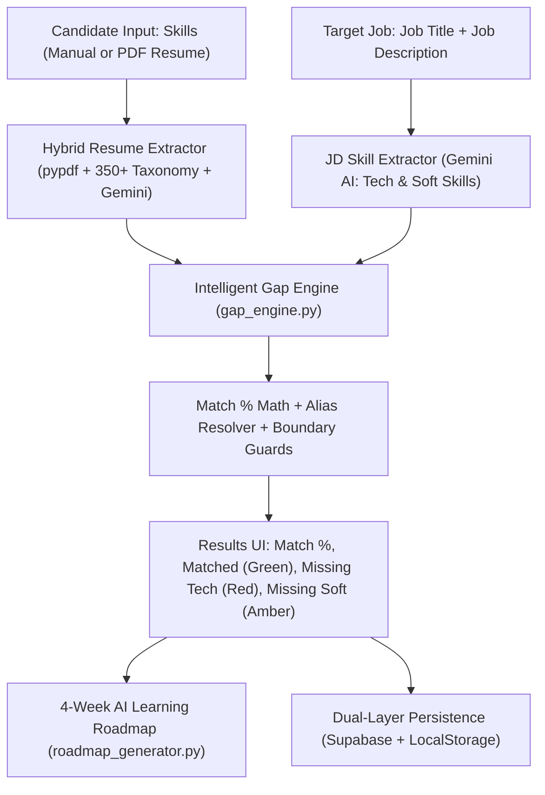

# 🎓 Bridge-IQ (SkillGap Analyzer) — Master Presentation & Viva Guide
> **Authors:** Anu Priya & Chandru  
> **Target:** Final Year Project Presentation & Viva Voce  
> **Status:** Live Revision Guide (Updated page-by-page)

---

## 📑 Table of Contents
1. [2-Minute Elevator Pitch (Opening Speech)](#1-2-minute-elevator-pitch)
2. [Complete Technology Stack & Tech Terms](#2-complete-technology-stack--tech-terms)
3. [How to "Run the Module Separately" (Reviewer Test Defense)](#3-how-to-run-the-module-separately)
4. [High-Level Overview of All Pages](#4-high-level-overview-of-all-pages)
5. [Page 1 Deep Dive: Landing Page & Navigation](#5-page-1-deep-dive-landing-page--navigation)
6. [Page 2 Deep Dive: Skill Gap Analyzer & Resume Extractor](#6-page-2-deep-dive-skill-gap-analyzer--resume-extractor)
   - [Core Purpose & Flow Diagram](#61-core-purpose--flow-diagram)
   - [The Mathematical Formula & Gap Engine](#62-the-mathematical-formula--gap-engine)
   - [Alias Resolution & False Substring Protection](#63-alias-resolution--false-substring-protection)
   - [Hybrid ATS Resume Extractor Pipeline](#64-hybrid-ats-resume-extractor-pipeline)
   - [4-Week AI Learning Roadmap](#65-4-week-ai-learning-roadmap)
   - [Live Modification Cheat Sheet for Reviewers](#66-live-modification-cheat-sheet)
   - [Top Viva Questions & Answers](#67-top-viva-questions--answers)
7. [Page 3 Deep Dive: Candidate Portal & Proctored Practice Engine (Upcoming)](#7-page-3-deep-dive-candidate-portal--proctored-practice-engine-upcoming)
8. [Page 4 Deep Dive: Employer & Recruiter Portal (Upcoming)](#8-page-4-deep-dive-employer--recruiter-portal-upcoming)
9. [Page 5 Deep Dive: Superadmin Command Center (Upcoming)](#9-page-5-deep-dive-superadmin-command-center-upcoming)
10. [Page 6 Deep Dive: Live Job Market Engine (Upcoming)](#10-page-6-deep-dive-live-job-market-engine-upcoming)
11. [Master Viva Questions & Defense Answers](#11-master-viva-questions--defense-answers)

---

# 1. 2-Minute Elevator Pitch
*Memorize this structured opening speech with your teammate:*

> **"Good morning/afternoon, Respected Examiners.**  
> Today, my teammate and I are presenting **Bridge-IQ (SkillGap Analyzer)** — an AI-powered talent intelligence and career acceleration platform.
>
> In traditional hiring, candidates submit static resumes without knowing why they get rejected, and employers receive thousands of unverified claims.
>
> **Bridge-IQ bridges this gap with a 3-role ecosystem:**
> 1. **Candidates** upload resumes or target job descriptions. Our hybrid ATS engine extracts skills and compares them against market demands, calculates an exact match score, identifies missing skills, and builds an adaptive 12-week learning roadmap. Candidates can then take a **proctored 2-stage technical assessment** (20 MCQs + 2 Live coding challenges) to earn verified badges.
> 2. **Recruiters & Employers** can post jobs, browse pre-verified talent scored on live coding and MCQs, and issue direct screening test invitations.
> 3. **Superadministrators** have a centralized governance center to monitor platform telemetry, review candidate code submissions, moderate jobs, and add custom exam questions.
>
> The platform is built using **React 19, Tailwind CSS v4, FastAPI (Python), Google Gemini AI, Supabase (PostgreSQL), and RapidAPI JSearch**."

---

# 2. Complete Technology Stack & Tech Terms

### A. Frontend Technologies
| Technology | Version / Spec | Purpose in Bridge-IQ | Why Chosen (Viva Defense) |
| :--- | :--- | :--- | :--- |
| **React** | `^19.2.8` | Core UI library for dynamic component rendering and reactive state. | Provides enhanced hooks, optimal reconciliation, and clean component modularity. |
| **Vite** | `^8.3.0` | Development server and production bundler. | 10x-50x faster than legacy Webpack via native ES modules and Hot Module Replacement (HMR). |
| **Tailwind CSS** | `^4.3.3` | Utility-first styling engine using `@import "tailwindcss";` and `@theme`. | Rapid responsive UI creation without massive CSS files or runtime overhead. |
| **React Router DOM** | `^7.18.4` | Single-Page Application (SPA) client-side routing. | Provides nested layouts (`CandidateLayout`) and role-based route protection. |
| **Supabase JS** | `^2.117.2` | Client authentication, session persistence, and PostgreSQL data access. | Eliminates custom backend JWT/cookie boilerplate while offering built-in row-level security. |
| **Oxlint** | `^1.81.0` | Ultra-fast Rust-based JavaScript/React linter. | Runs 50x–100x faster than ESLint, catching bugs and syntax errors during builds. |

### B. Backend Technologies
| Technology | Spec | Purpose in Bridge-IQ | Why Chosen (Viva Defense) |
| :--- | :--- | :--- | :--- |
| **Python** | `3.10+` | Core backend runtime powering AI logic, text processing, and evaluation. | Standard industry language for AI/LLM integration, regex parsing, and scripting. |
| **FastAPI** | Latest | Asynchronous RESTful API framework. | Native `async/await`, high throughput, and automatic interactive Swagger documentation. |
| **Uvicorn** | ASGI | Production ASGI web server running FastAPI. | High concurrency support built on `uvloop`. |
| **Pydantic** | v2 | Request/response data validation and sanitization. | Enforces strict type schemas before reaching business logic. |
| **PyPDF** | Latest | Binary stream parsing and text extraction from uploaded PDF resumes. | Lightweight, pure Python, and has no heavy external C/OCR dependencies. |
| **Google Generative AI** | `google-generativeai` | Connects to Gemini models (`gemini-3.8-flash`, `gemini-2.0-flash`). | Low latency, high JSON accuracy, and automated skill extraction. |
| **Subprocess Runner** | Python `subprocess` | Executes candidate submitted code (Python, JS) against 6 unit test cases in isolation. | Runs candidate scripts in a separated process with execution time limits. |

### C. Database & External Services
| Technology | Purpose in Bridge-IQ |
| :--- | :--- |
| **Supabase (PostgreSQL)** | Cloud relational database storing profiles, reports, employer jobs, and assessment invitations. |
| **RapidAPI JSearch** | Real-time global job aggregator querying live listings from LinkedIn, Indeed, and Glassdoor. |
| **Browser LocalStorage** | **Dual-Layer Persistence Fallback:** If Supabase is offline or during guest preview, all analyses, roadmaps, and test scores persist locally. |

---

# 3. How to "Run the Module Separately"
*(Crucial: Reviewers ask this to verify you didn't just clone a full website template)*

### Method A: Run Backend API Endpoints via Swagger UI (Best Demonstration)
1. In terminal:
   ```bash
   cd backend
   uvicorn main:app --reload --port 8000
   ```
2. Open browser to: `http://127.0.0.1:8000/docs`
3. Show the reviewer the interactive Swagger docs:
   - **Gap Module:** Click `POST /api/analyze-gap` $\rightarrow$ Click **Try it out** $\rightarrow$ Execute sample payload $\rightarrow$ Show JSON output.
   - **Quiz Module:** Click `POST /api/generate-quiz` $\rightarrow$ Pass `{"skill": "Python"}` $\rightarrow$ Show generated 20 questions.
   - **Code Evaluator:** Click `POST /api/evaluate-coding-challenge` $\rightarrow$ Execute test cases standalone.

> **Viva Defense Line:**  
> *"Sir/Madam, our backend is completely decoupled from the frontend. Every business logic service can be tested independently through our RESTful OpenAPI/Swagger interface."*

### Method B: Run Backend Services Directly via Terminal (Python CLI)
Run standalone tests inside the `backend` directory:
* **Test Gap Engine:**
  ```bash
  python -c "from services.gap_engine import calculate_skill_gap; print(calculate_skill_gap(['Python', 'SQL'], ['Python', 'Docker', 'AWS'], ['Communication']))"
  ```
* **Test Resume Taxonomy Scanner:**
  ```bash
  python -c "from services.resume_extractor import scan_text_for_taxonomy_skills; print(scan_text_for_taxonomy_skills('Experienced with Python, React, PostgreSQL, Docker, and Git'))"
  ```

### Method C: Run Frontend Modules Directly via URL Routes
* Skill Gap Analyzer: `http://localhost:5173/analyzer`
* Proctored Assessment Engine: `http://localhost:5173/candidate/practice`
* 12-Week Roadmap: `http://localhost:5173/candidate/roadmap`
* Live Job Market: `http://localhost:5173/jobs`
* Employer Portal: `http://localhost:5173/employer`
* Superadmin Command Center: `http://localhost:5173/admin`

---

# 4. High-Level Overview of All Pages

| # | Page / Route | Component File | Main Purpose |
| :- | :--- | :--- | :--- |
| 1 | **Landing Page (`/`)** | `LandingPage.jsx` | Public storefront with 3-role live interactive sandbox, animated market ticker, and Bento grid. |
| 2 | **Skill Gap Analyzer (`/analyzer`)** | `SkillGapAnalyzer.jsx` | Ingests candidate skills or PDF resume, extracts skills, compares against JD, calculates match score, and builds 4-week AI roadmap. |
| 3 | **Candidate Home (`/candidate/home`)** | `CandidateHome.jsx` | Candidate cockpit showing readiness score, pending recruiter test invites, profile completion, and target roles. |
| 4 | **Proctored Practice (`/candidate/practice`)** | `CandidatePractice.jsx` | 2-stage proctored exam (20 MCQs with code snippets + 2 Live coding challenges against 6 test cases). |
| 5 | **12-Week Roadmap (`/candidate/roadmap`)** | `CandidateRoadmap.jsx` | 3-phase structured curriculum (Foundations, Competency, Production) tailored to roles like AI/ML or Full-Stack. |
| 6 | **Candidate Profile (`/candidate/profile`)** | `CandidateProfile.jsx` | 18-field professional profile builder with verified skill badges and resume management. |
| 7 | **Employer Portal (`/employer`)** | `EmployerPortal.jsx` | Recruiter dashboard to post/edit jobs, search pre-verified talent, and issue assessment invitation tokens. |
| 8 | **Superadmin Portal (`/admin`)** | `AdminPortal.jsx` | Governance center for master admins: platform telemetry, user role elevation, job moderation, question curation, and code submission audits. |
| 9 | **Live Job Market (`/jobs`)** | `LiveJobSearch.jsx` | Real-time global job search powered by RapidAPI JSearch with location filters and 1-click external apply. |

---

# 5. Page 1 Deep Dive: Landing Page & Navigation

### 5.1 The 5 Interactive Sections
1. **Hero & 3-Role Live Sandbox:**
   - Left side: High-conversion headline, engine version pill badge, and CTAs.
   - Right side: Interactive sandbox toggling between **Senior Full-Stack** (74% match), **AI/ML Engineer** (42% match), and **Cloud Architect** (61% match), dividing skills into *Verified by Proof-of-Work*, *Market Delta Detected*, and *Critical Disqualifiers*.
2. **Infinite Animated Market Marquee Ticker:**
   - Displays real-time market trends (`TypeScript +42% Demand`, `Docker 78%`, `Gemini API +300%`).
   - Powered by hardware-accelerated CSS keyframes in `index.css`.
3. **Bento Grid Architecture Showcase:**
   - 4 asymmetric feature cards: *Context-Aware Artifact Parsing*, *4-Layer Credibility*, *Live Market Alignment (JSearch)*, and *Adaptive Learning Velocity*.
4. **Interactive Gap Simulator ("Try It Before You Sign Up"):**
   - Allows visitors to type any target role (e.g. *Data Engineer*) and view an instant simulated skill matrix without logging in.
5. **Footer CTA & Credibility Badges:**
   - Final call to action with trust badges (*Zero Spam*, *Instant Verification*, *Privacy First*).

---

### 5.2 Why `App.css` is Empty
* In modern React with **Tailwind CSS v4**, styling is done via utility classes (`className="bg-emerald-700 p-4"`) directly on elements.
* Vite's default `App.css` styles (e.g., `#root { max-width: 1280px; margin: 0 auto; }`) conflict with full-width responsive layouts.
* All global CSS, `@import "tailwindcss";`, custom theme variables (`--bg-page: #FAFCF8`), Google Font (`Plus Jakarta Sans`), and marquee keyframes are defined cleanly inside **`frontend/src/index.css`**.

---

### 5.3 Live Modification Cheat Sheet
*Keep `frontend/src/components/LandingPage.jsx` open in VS Code. Vite's Hot Module Replacement (HMR) updates the browser in <50ms when you press `Ctrl + S`:*

1. **Change the Main Headline:**
   - Lines 48–53: Edit `"The Intelligence Layer for Your Engineering Career."`
2. **Change Button Text or Colors:**
   - Lines 60–65: Change `"Start Free Analysis"` text.
   - Change `bg-emerald-700 hover:bg-emerald-800` to `bg-indigo-600 hover:bg-indigo-700` or `bg-blue-600 hover:bg-blue-700`.
3. **Add Student / College Name Badge:**
   - Lines 43–46: Replace `"Bridge-IQ Engine v2.0"` with:
     ```jsx
     Developed by Anu Priya & Team | [Your College Name]
     ```
4. **Modify Sandbox Roles / Skills:**
   - Lines 9–25: Add or change skills in the `rolesData` dictionary.
5. **Redirect Button Target:**
   - In `App.jsx`, line 133: Change `onSignUp={() => navigate('/candidate/signup')}` to `onSignUp={() => navigate('/analyzer')}` to jump directly to the Analyzer!

---

### 5.4 Landing Page Viva Q&A
* **Q: Is the landing page sandbox data coming from the database?**  
  *A:* No, it uses a client-side state model for instantaneous, zero-latency preview before users sign in. Live database and API integration begins when users access the Analyzer, Candidate, or Job search modules.
* **Q: How does the marquee animation work?**  
  *A:* It uses `@keyframes marquee` in `index.css` running infinite translateX transitions, completely handled by CSS without JavaScript execution loops.
* **Q: Is the landing page mobile responsive?**  
  *A:* Yes, Tailwind breakpoints (`sm:`, `md:`, `lg:`) adjust the 2-column hero into a single vertical column and convert the desktop nav into a mobile dropdown.

---

---

# 6. Page 2 Deep Dive: Skill Gap Analyzer & Resume Extractor

### 6.1 Core Purpose & Flow Diagram
The **Skill Gap Analyzer** (`/analyzer`) is the primary diagnostic copilot in Bridge-IQ. It takes a candidate's uploaded resume or manually entered skills, contrasts them against a target job description, computes a verified match percentage, classifies missing skills, and builds an AI-driven 4-week learning roadmap.



---

### 6.2 The Mathematical Formula & Gap Engine
* Located in: `backend/services/gap_engine.py`
* Mathematical formulation:
$$\text{Match Percentage} = \left( \frac{|\text{Matched Skills}|}{|\text{Total Required Tech Skills}| + |\text{Total Required Soft Skills}|} \right) \times 100$$

* **Deduplication:** Required technical skills and soft skills are converted to sets to guarantee accurate denominators.
* **Rounding:** Rounded to 1 decimal place using `round(..., 1)`.

---

### 6.3 Alias Resolution & False Substring Protection
1. **Canonical Alias Mapping (`SKILL_ALIASES`):**
   * Resolves common synonyms: `k8s` $\rightarrow$ `kubernetes`, `psql` $\rightarrow$ `postgresql`, `react.js` $\rightarrow$ `react`, `ts` $\rightarrow$ `typescript`, `py` $\rightarrow$ `python`, `ci/cd` $\rightarrow$ `cicd`.
2. **False Positive Guard (`STRICT_EXACT_MATCH_TERMS`):**
   * Guard set: `{'c', 'r', 'go', 'java', 'sql', 'git', 'rust', 'ruby', 'dart', 'php', 'bash', 'css'}`.
   * **Crucial Rule:** These words are strictly prohibited from naive substring matching.
   * *Example:* If a candidate has `JavaScript`, it will **never** match a required skill of `Java`. If a candidate has `CSS`, it will **never** match `C`.
3. **Token-Boundary Regex Matching:**
   * Uses `rf'(?:^|[\s\-_/]){re.escape(shorter)}(?:$|[\s\-_/])'` with length $\ge 4$ characters to ensure partial words don't trigger accidental matches.

---

### 6.4 Hybrid ATS Resume Extractor Pipeline
* Located in: `backend/services/resume_extractor.py` & `frontend/src/components/ResumeUploader.jsx`
1. **Binary Stream Handling:** Uploaded PDF files are converted to Base64 in the browser, sent via `POST /api/extract-resume`, and decoded into raw bytes in Python.
2. **PyPDF Page Extraction:** Parses bytes page-by-page and sanitizes binary control characters (`[\x00-\x08\x0b\x0c\x0e-\x1f]`).
3. **Dual Extraction Strategy (Fault Tolerant):**
   * **Path 1 (AI Semantic Extractor):** Sends text to Google Gemini 3.8-Flash with a strict ATS talent recruiter prompt (6-second network timeout guard).
   * **Path 2 (350+ Canonical Taxonomy Scanner):** Runs a high-recall boundary regex scanner across a curated dictionary of 350+ industry technical skills.
   * **Result:** Merges and deduplicates skills from both paths so **even if Gemini API is slow or offline, the taxonomy scanner extracts all skills flawlessly with zero empty returns.**

---

### 6.5 4-Week AI Learning Roadmap
* Located in: `backend/services/roadmap_generator.py` & `frontend/src/components/LearningRoadmap.jsx`
* Analyzes the candidate's **missing technical skills** and targets their desired job role.
* Generates a 4-week structured curriculum:
  * **Week 1:** Foundations & Environment Setup
  * **Week 2:** Core Implementation & Mini-Project
  * **Week 3:** Advanced Architecture & Best Practices
  * **Week 4:** Capstone Project, Interview Prep & Deployment
* **PDF Export Feature:** Includes a built-in **"Save PDF"** button (`window.print()`) for offline reference.

---

### 6.6 Live Modification Cheat Sheet for Reviewers
*Keep `frontend/src/components/SkillGapAnalyzer.jsx` open in VS Code:*

1. **Change Match Score Color Thresholds (Lines 132–136):**
   ```javascript
   const getMatchColor = (percentage) => {
     if (percentage >= 70) return 'text-emerald-950 bg-emerald-50 border-emerald-300';
     if (percentage >= 40) return 'text-amber-950 bg-amber-50 border-amber-300';
     return 'text-rose-950 bg-rose-50 border-rose-300';
   };
   ```
   *Change `percentage >= 70` to `80` if the reviewer asks to increase the passing bar.*
2. **Pre-fill Default Job Description (Lines 17–18):**
   ```javascript
   const [jobTitle, setJobTitle] = useState(incomingJobTitle || 'Full-Stack Developer');
   const [jobDescription, setJobDescription] = useState(incomingJobDesc || 'Looking for an experienced developer with React, Node.js, Docker, PostgreSQL, and AWS.');
   ```
3. **Weight Technical Skills Higher than Soft Skills (`backend/services/gap_engine.py`):**
   ```python
   tech_pct = (len(matched_tech) / len(req_tech)) * 100 if req_tech else 100
   soft_pct = (len(matched_soft) / len(req_soft)) * 100 if req_soft else 100
   match_percentage = round((0.8 * tech_pct) + (0.2 * soft_pct), 1)
   ```

---

### 6.7 Top Viva Questions & Answers
* **Q1: How do you avoid false positive substring matches like "Java" matching "JavaScript"?**  
  *A:* We maintain a `STRICT_EXACT_MATCH_TERMS` guard in `gap_engine.py` for terms like `c`, `r`, `go`, `java`, `sql`, and `css` that prevents substring matching and enforces exact token boundaries.
* **Q2: What happens if Gemini API fails during resume parsing?**  
  *A:* We use a hybrid extraction model. If Gemini times out (6-second guard), our deterministic 350+ skill taxonomy scanner runs across the text to capture all canonical skills.
* **Q3: Can a candidate modify their skills after uploading a resume?**  
  *A:* Yes, each skill renders as an interactive tag with a delete button (`×`), and new skills can be added manually via the skill input field.
* **Q4: Where are the skill gap reports saved?**  
  *A:* In the `skill_gap_reports` table on Supabase PostgreSQL. If offline or exploring as a guest, it seamlessly caches in `localStorage`.
* **Q5: What if the backend server is offline while testing the Analyzer?**  
  *A:* `SkillGapAnalyzer.jsx` has a client-side offline fallback (lines 83–124) that extracts skills via browser regex (`extractAllResumeSkills`) and calculates the match score locally.

---

*(This guide will be updated after each page review!)*

